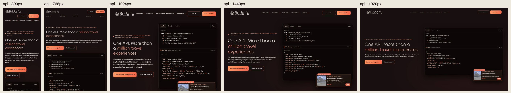
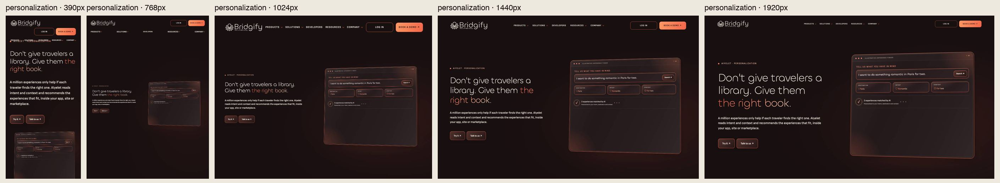
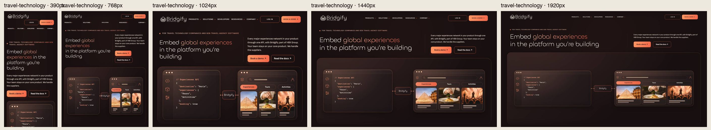
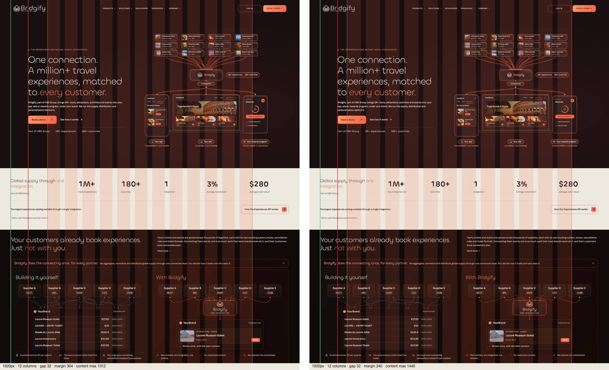
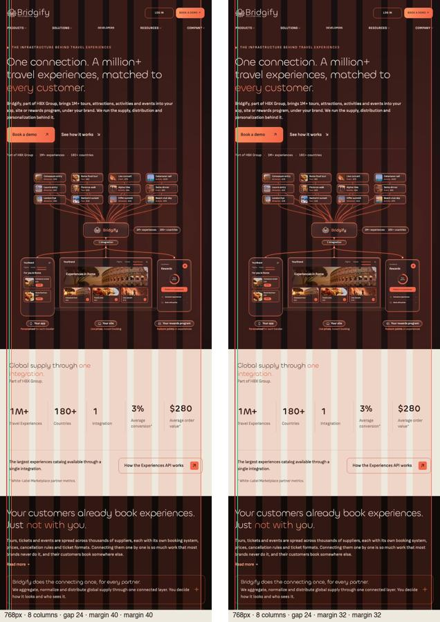
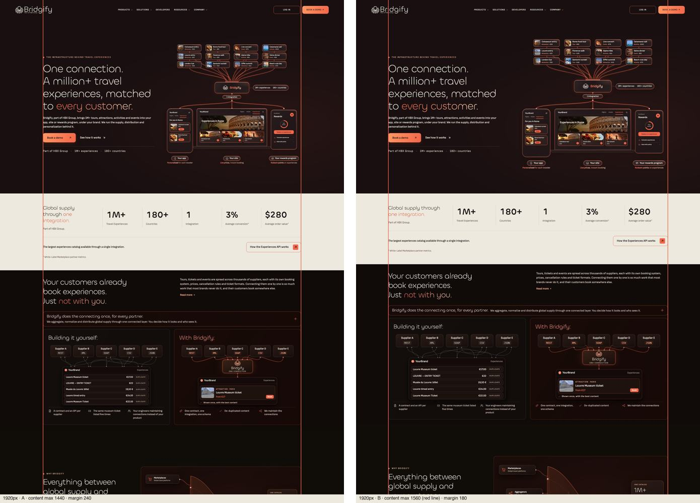
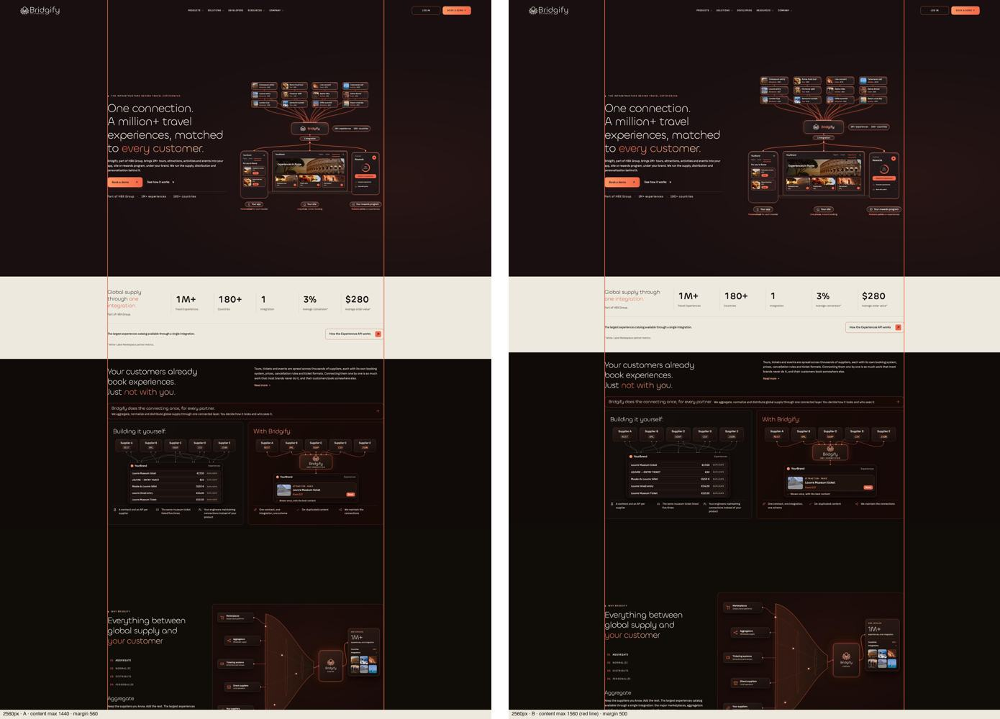

# SPACING-GRID-PLAN · מערכת ריווח וגריד אחת לטלפון, טאבלט ודסקטופ

**מצב (17 בנובמבר 2026):** התוכנית אושרה בכיוון הכללי. כל שלב מאושר בנפרד לפני שממשיכים.

| שלב | מצב |
|---|---|
| 1 · ביקורת | אושר 17 בנובמבר 2026 |
| 2 · breakpoints וגריד | אושר 17 בנובמבר 2026: תוכן עד 1560 (B), שוליים בטאבלט 32, התפריט על קו התוכן |
| 3 · טבלאות ריווח, יישור, גדלי טקסט | אושר 17 בנובמבר 2026: ריווח (סקשן 96 בדסקטופ), כותרת מפוצלת, סולם טקסט, header צמוד ומצומצם. פתוח: גובה כפתור, בלוקי דמו גבוהים |
| 4 · ארכיטקטורה | אושר 17 בנובמבר 2026 |
| 5 · בדיקות | אושר 17 בנובמבר 2026 (נבנה: `grid-check.py`, ‏52/52 על דף הבית בניסוי) |
| 6 · סדר מעבר | ממתין לאישור (עודכן 17 בנובמבר 2026) |

הכול במעבדה בלבד. קבצי האתר החיים ו־`index.html` (V1) לא משתנים בלי אישור מפורש. הטקסט מגיע רק מ־Copy v4. אין מסגרות ואין שורות Replay/Pause.

**חומרי הביקורת** נמצאים ב־`output/element-lab/grid-plan/`:
- `audit.py`: המדידה של 10 העמודים ב־7 רוחבים.
- `refs.py`: המדידה של Stōkt ו־EnduroSat.
- `measure.json`, `refs.json`: התוצאות.
- `shots/`: צילום מסך ראשון לכל עמוד ולכל רוחב, וצילום עמוד מלא ל־index-v2 ול־api.
- `sheets/`: גיליון לכל עמוד ב־390 / 768 / 1024 / 1440 / 1920.
- `refs/`: צילומי הרפרנסים.

## הקשר
במעבדה (`output/element-lab/adaptive/`, ענף PR #9) הוכחה מערכת ריווח לטלפונים: סולם 8pt, תפקידים (label, title, text, more, actions, link, control, content, visual, dots, deco) וערך אחד לכל זוג תפקידים. היא עובדת רק ב־≤599, ורק דרך `rhythm.js` שכותב `!important` אחרי הצביעה הראשונה (כלל M2 נכשל ב־10 העמודים). הטאבלט והדסקטופ עדיין מתנהגים לפי 167 קובצי CSS, ולכן כל עמוד דרש תיקונים משלו.
המטרה: מסמך תוכנית מאושר (`SPACING-GRID-PLAN.md`) למערכת אחת לשלושת סוגי המכשירים, שמבוססת על מדידות. מבצעים שלב אחרי שלב, ואחרי כל שלב מקבלים אישור. **אין שינוי בקבצים החיים**, אין קומיט ל־main ואין פריסה.

מקורות שנקראו: AGENTS.md (כולל פרק ה־git מענף PR #9), DESIGN.md §3–4, §8, §12–15, TYPOGRAPHY.md, brand-typography.css, ומענף PR #9 (חולץ ב־`git archive` לסקראצ'פד): WORKFLOW.md, MOBILE-RULES.md, tokens.css, actions.css, layout.css, rhythm.js, roles/*.js, check.py, verify.py, check-all.sh, compliance.md, patterns.css.

---

## שלב 1 · ביקורת: מה האתר עושה היום (נמדד)

**איך נמדד:** סקריפט Playwright (`output/element-lab/grid-plan/audit.py`) הגיש את ה־worktree הזה (main, d51e962) בזמן ריצה. הוא מדד את כל הסקשנים ב־10 העמודים ב־390, 768, 820, 1024, 1280, 1440 ו־1920, עם reduced-motion. הסקריפט `refs.py` מדד את Stōkt ואת EnduroSat ב־390, 768, 1440 ו־1920. התוצאות נשמרו ב־`measure.json`, ב־`refs.json` וב־84 צילומי מסך.

### 1א · CSS
- 167 קובצי CSS, 1,358 פעמים `!important`, ו־47 רוחבי breakpoint שונים (בין 360 ל־1800). השכיחים: 760 (140 פעמים), 900/901 (140), 700 (60), 1100 (61) ו־600 (34).
- לכל עמוד נטענים 17–40 קבצים, עם 484–610 `!important` ו־14–31 breakpoints. כ־400 מתוך ה־`!important` של כל עמוד מגיעים מקבצים משותפים: shared-navigation 201, brand-typography 103, brand-faq 51 ו־brand-consistency 34.
- **ממצא מבני:** כל ה־CSS הקיים לא שייך לאף layer, ולכן הוא גובר על כל `@layer` חדש. ה־`!important` שלו יגבר גם על `!important` בשכבות. לכן כל ארכיטקטורה חדשה חייבת קודם להכניס את ה־CSS הקיים לשכבת `legacy`.

### 1ב · שוליים וקו התחלה (צד שמאל של כותרת הסקשן, ברוב הסקשנים)
| רוחב | עמודים פנימיים (`4%`) | דף הבית (`3vw+10`) | חריגים |
|---|---|---|---|
| 390 | 16 | 24 | 13, 14, 20, 23, 36 |
| 768 | 31 | 33 (בהירו 24) | 23–28, 38, 56 |
| 1024 | 41 | 41 | 34, 38, 69 |
| 1280 | 51 | 47 | 42, 86 |
| 1440 | 58 | 53 | 43–48, 96 (OTAs hero: 258) |
| 1920 | 77 | 68–71 | hero דף הבית 180 (תקרה 1560), hero airlines 160 (תקרה 1600), OTAs 426 |
**מסקנה:** יש שתי נוסחאות שוליים ואין תקרה לתוכן, מלבד שני הירו. ב־1920 ההירו של דף הבית מתחיל ב־x=180 והסקשנים שמתחתיו ב־x=68, כלומר הקו השמאלי נשבר. במעבדה הטאבלט כבר מקבל 40px (`layout.css`).

### 1ג · קצב הסקשנים (padding עליון/תחתון, בלי ההירו)
- טווח 0–88 בכל רוחב, חציון 48 ב־390, 56 ב־768–1024 ו־64 ב־1280 ומעלה.
- באותו עמוד יש ערכים שונים לגמרי. למשל API ב־1440: 86/86, ואז 34/44 בסקשן integration. personalization: 64, ‏28 ו־16. FAQ תמיד 72 או 80.
- ה־padding העליון של ההירו: 116–236.

### 1ד · גודל כותרות
| רוחב | כותרת סקשן | הירו | חריגים |
|---|---|---|---|
| 390 (בלי שכבת המעבדה) | 30–36 | 34–42 | 23, 24 |
| 768 / 820 | 36 | 40 (OTAs 48, marketplace 24) | 28, 32, 34 |
| 1024 | 36 | 40 | |
| 1280 | 37–38 | 46 | |
| 1440 | 42–43 | 52 | 27 (sources), 36, 37 |
| 1920 | 44 | 60 | 28, 40 |

### 1ה · ריווח בתוך קבוצת הכותרת (כל הרוחבים)
- label→title: ‏10–28, רוב הערכים 18–22.
- title→text: ‏16–26.
המעבדה קבעה בטלפון 16 ו־24 בדיוק.

### 1ו · רפרנסים (נמדד)
- **EnduroSat:** השוליים נזילים, כ־4.2% מהרוחב: 18 ב־390, 32 ב־768, 60 ב־1440 ו־80 ב־1920. אין תקרה, והטיפוגרפיה גדלה עם vw.
- **Stōkt:** שוליים 16–40, padding סקשן 80/80 בדסקטופ ו־20 בטלפון, וטקסט גוף ברוחב 411–520px גם ב־1920. התוכן הארוך ממורכז בעמודה צרה.

### 1ז · צילומים
השבר בקו השמאלי ב־1920: הקו האדום (x=180) הוא ההירו, והקו הירוק (x=68) הוא כל שאר הסקשנים.


גיליון לכל עמוד, ברוחבים 390 · 768 · 1024 · 1440 · 1920:









---

## שלב 2 · שיטת breakpoints אחת וגריד אחד לכל סוג מכשיר (הצעה)
| | טלפון | טאבלט | דסקטופ |
|---|---|---|---|
| טווח | ≤599 | 600–1023 | ≥1024 |
| רוחבי בדיקה | 320, 390, 430 | 768, 820, 1023 | 1024, 1280, 1440, 1920 |
| עמודות | 4 | 8 | 12 |
| מרווח בין עמודות | 16 | 24 | 32 |
| שוליים | 24 (מוכח) | **32 (אושר)** | `clamp(40px, 4vw, 64px)`: ‏41 ב־1024, ‏51 ב־1280, ‏58 ב־1440 |
| תקרת תוכן | — | — | **1560px (B, אושר 17 בנובמבר 2026)**: `max(clamp(40px, 4vw, 64px), (100vw − 1560px)/2)`. ‏58 ב־1440, ‏180 ב־1920, ‏500 ב־2560 |

- **למה:** בכל סוג מכשיר המרווח בין העמודות הוא כחצי מהשוליים. 4% הוא מה שהעמודים הפנימיים כבר עושים, וקרוב ל־EnduroSat, כך שב־1024–1440 התזוזה היא 0–6px. התקרה מתקנת את השבר ב־1920.
- **רקעים, ארט (`deco`) ובמות דמו רשאים לחרוג מהשוליים** עם `.bf-bleed`. רק התוכן נתפס בגריד.
- מידת טקסט: פסקה עד 60ch (כ־560px). בפיצול כותרת/מבוא בדסקטופ הכותרת תופסת עמודות 1–7 והמבוא עמודות 8–12.
- **הוחלט (המשתמש, 17 בנובמבר 2026):** במסכים רחבים מאוד חייב להיות max-width לתוכן. ההצעה: תוכן עד 1312px (מסגרת 1440), ממורכז, והרקעים נמשכים לכל הרוחב. בשלב 2 מציגים צילומים ב־1920 ו־2560 של 1312 לעומת 1440 ונועלים את המספר.
- **הוחלט (המשתמש, 17 בנובמבר 2026):** שוליים בטאבלט 32.
- **הוחלט (המשתמש, 17 בנובמבר 2026): ה־header על קו התוכן.** הפס הצף זז כך שהלוגו והכפתור האחרון יושבים על הקו, והריווח הפנימי של הפס נשאר מחוץ לקו, כמו ב־Linear. הריווח הפנימי עובר לסולם 8: ‏16 בטאבלט ו־24 בדסקטופ (היום 14, 18 או 24, לפי הרוחב). נמדד בניסוי: הלוגו והכפתור על הקו בדיוק ב־768, ‏1023, ‏1024, ‏1280, ‏1440, ‏1920 ו־2560. חריג אחד: ב־600 הכפתור האחרון יוצא 4px פנימה.

### 2א · ההצעה מצוירת על דף הבית (17 בנובמבר 2026)
`output/element-lab/grid-plan/overlay.py` מצלם את דף הבית ומצייר מעליו את העמודות המוצעות (פסים קורל), את השוליים (קו קורל), ואת הקו השמאלי של היום: ירוק לסקשנים, אדום להירו כשהוא שונה. באתר עצמו לא משתנה כלום.

| רוחב | הקו של היום: הירו / סקשנים | מקסימום 1312 | מקסימום 1440 |
|---|---|---|---|
| 1440 | 53 / 53 | שוליים 64 (זז 11px פנימה) | שוליים 58 (כמו העמודים הפנימיים היום) |
| 1920 | 180 / 68 | שוליים 304 | שוליים 240 |
| 2560 | 500 / 87 | שוליים 624 | שוליים 560 (קרוב להירו של היום) |




**המלצה לתקרה: 1440.** ב־1440, הרוחב הנפוץ ביותר בדסקטופ, העמודים הפנימיים לא זזים בכלל (58px), ודף הבית זז 5px. מעל 1440, ההירו והסקשנים מתיישרים לאותו קו. עם 1312 כל האתר זז פנימה גם ב־1440.

| טאבלט 768 | הקו של היום: הירו / סקשנים | שוליים 40 | שוליים 32 |
|---|---|---|---|
| דף הבית | 24 / 33 | זז 7–16 פנימה | זז 1–8 |



**המלצה לטאבלט: 32.** זה הכי קרוב למה שיש היום (31–33 בעמודים הפנימיים), זהה ל־EnduroSat ב־768, ונמצא על סולם 8. הערך 40 (שהוגדר קודם ב־`layout.css` של המעבדה) נותן יותר אוויר, אבל מזיז את כל הטאבלט.

### 2ב · ניסוי פנימי: דף הבית מסודר לפי תקרה אחת (17 בנובמבר 2026)
המשתמש הרגיש שבמסך רחב הקו המוצע (1440) צר מדי, והציע ללכת על הקו האדום, הקצה של ההירו היום. ‏`try-cap.py` מזריק את `try-cap.css` (מעבדה בלבד) ומצלם את דף הבית בשתי גרסאות:
- **A:** תוכן עד 1440.
- **B:** תוכן עד 1560, כלומר הקו האדום.

בשתיהן השוליים הם `max(clamp(40px, 4vw, 64px), (100vw − cap) / 2)`.

| רוחב | A · ‏1440 | B · ‏1560 | בדיקה |
|---|---|---|---|
| 1440 | 58 | 58 | זהות, התקרה עוד לא פועלת |
| 1920 | 240 | 180 | כל הסקשנים על הקו, ±2px, בלי גלילה אופקית |
| 2560 | 560 | 500 | כל הסקשנים על הקו, ±2px |




**הוחלט (המשתמש, 17 בנובמבר 2026): B, תוכן עד 1560.** המשתמש בדק אותו בתצוגה החיה מול A ומול המצב היום. ההירו נשאר כמו היום, וכל הסקשנים מתיישרים לקו שלו. גם Linear נמדד (תקרה 1280, טלפון 24, טאבלט 34–36, לוגו על קו התוכן). הוא צר יותר מ־A ולא נבחר.

**מה הניסוי לימד:**
- **B משאיר את ההירו בדיוק כמו היום ומיישר אליו את כל השאר.** ב־A גם ההירו מצטמצם (הדיאגרמה קטנה יותר), ו־"Global supply through one integration" נשבר לשלוש שורות ב־1920.
- **חמישה קובצי סקשן בדף הבית מקבעים `padding: … 3.7%`** ולא קוראים את `--home-gutter`: ‏home-products-v2, ‏home-problem-v2, ‏home-numbers-v2 (שני סקשנים), ‏home-cta-v2. גם partner-results מרפד עמודה פנימית. בניסוי הם הופנו לשוליים המשותפים. במיגרציה זה מתוקן במקור.
- **ה־header (לוגו ותפריט) נשאר בקצה המסך** (85px ב־1920, 106px ב־2560) ולא על קו התוכן. צריך להחליט אם גם הוא נכנס לתקרה.

### 2ג · header צמוד לראש הדף, ומצומצם בגלילה (אושר 17 בנובמבר 2026)
**הבקשה (המשתמש, 17 בנובמבר 2026):** התפריט לא נראה כבלוק צף נפרד, אלא כ־hero header רגיל שהוא חלק מהדף ומחובר לקצה העליון. בגלילה הוא נהיה תפריט קצת מצומצם, שעדיין צמוד לקצה העליון, בלי לפגוע בקריאוּת.
- **בראש הדף:** הפס ברוחב מלא, מתחיל ב־top 0, בלי פינות מעוגלות ובלי רקע. הוא שקוף מעל ההירו, בגובה 88.
- **בגלילה** (`.is-stuck`, ש־`shared-navigation.js` מוסיף אחרי 24px): אותו פס, צמוד לקצה העליון וברוחב מלא. הגובה יורד ל־64, עם המשטח הכהה של האתר וקו הקורל הדק מתחתיו. הלוגו יורד מ־40 ל־32 והכפתורים מ־44 ל־36.
- **מה לא משתנה:** טקסט הניווט והכפתורים 12px, והצבעים. הריווח בצדי הפס שווה לשולי התוכן, ולכן הלוגו והכפתור האחרון יושבים על קו התוכן בשני המצבים. נמדד: 60 ב־1512, ‏180 ב־1920.
- **איפה:** בדסקטופ, ומ־17 בנובמבר 2026 גם בטאבלט (בקשת המשתמש).
  - **טאבלט 600–950** (התפריט בשתי שורות): הפס צמוד לראש הדף וברוחב מלא. בגלילה הגובה יורד מ־123 ל־74–78: הלוגו מ־30 ל־26, הכפתורים מ־38 ל־32, והטקסט לא משתנה. כשגוללים למטה הפס עדיין יוצא מהמסך, ובגלילה למעלה הוא חוזר מצומצם.
  - **951–1023:** האתר מציג כאן את התפריט בשורה אחת, ולכן חלים הגדלים של הדסקטופ (88 ← 64).
  - הלוגו והכפתור האחרון על קו התוכן (32) בכל הרוחבים.
- **קבצים:** `header-compact.css` (מעבדה). בתצוגה החיה הכפתור "תפריט בגלילה".

## שלב 3 · טבלת ריווח לכל סוג מכשיר (הצעה; ערכי הטלפון נשארים)
| זוג | טוקן | טלפון | טאבלט | דסקטופ |
|---|---|---|---|---|
| label→title | `--bf-gap-label-title` | 16 | 16 | 24 |
| title→text | `--bf-gap-title-text` | 24 | 24 | 32 |
| text→text | `--bf-gap-text-text` | 16 | 16 | 16 |
| text→more | `--bf-gap-text-more` | 8 | 8 | 8 |
| →actions | `--bf-gap-to-actions` | 32 | 40 | 48 |
| button↔button | `--bf-gap-actions-inner` | 12 | 12 | 16 |
| →link | `--bf-gap-to-link` | 16 | 16 | 24 |
| →control | `--bf-gap-to-control` | 32 | 40 | 48 |
| control→content | `--bf-gap-control-content` | 16 | 24 | 32 |
| →content | `--bf-gap-to-content` | 32 | 48 | 64 |
| hero→visual (כשמוערם) | `--bf-gap-to-visual` | 48 | 64 | 64 |
| ראש/תחתית סקשן | `--bf-section-y` | 64 | 80 | 96 (אושר מול 80 ו־128) |
| header→label בהירו | `--bf-hero-top` | 48 | 64 | 80 |
| card pad / gap | `--bf-card-pad` / `--bf-card-gap` | 20 / 16 | 24 / 24 | 32 / 32 |

- **הנימוק (נכתב במסמך לכל שורה):** ריווח של קריאה (text→text, ‏text→more) קשור לגוף 16px, שלא משתנה, ולכן הוא קבוע בכל המכשירים.
- ריווח שקשור לכותרת גדל עם הכותרת (28 → 36 → 44), בערך פי 0.75 מגודלה.
- ריווח מאקרו (סקשן, תוכן) גדל פי 1.25 בטאבלט ופי 1.5 בדסקטופ, מעוגל לסולם 8.
- 96 = הגבול העליון של DESIGN §8. ‏Stōkt משתמש ב־80 בדסקטופ. היום החציון הוא 64 והטווח 0–88.
- **סקשן במה כהה** בגובה מסך (`100svh`) נשאר בגובה המסך. הריווח שלו הוא מינימום.
- **טיפוגרפיה (רק לציון, לא משנים כאן):** טלפון 28 (מאושר). טאבלט 36 לכל הכותרות. דסקטופ לפי הטוקנים הקיימים `--type-section` / `--type-hero`.
- **החלטות פתוחות שעוברות לכאן:** כפתור 40 או 44; גובה הכפתור בטאבלט ובדסקטופ (DESIGN: 54–56 היום); בלוקי דמו גבוהים.

**אושר (המשתמש, 17 בנובמבר 2026):** הטבלה, עם ריווח סקשן של 96 בדסקטופ. האפשרויות שנבדקו בתצוגה החיה היו 80 (Stōkt), ‏96 ו־128 (Linear).

### 3א · ניסוי פנימי על דף הבית (17 בנובמבר 2026)
התצוגה החיה (`output/element-lab/grid-plan/live.html`, כפתור "ריווח · שלב 3") מריצה את הטבלה על דף הבית בטאבלט ובדסקטופ. היא משתמשת באותה מפת תפקידים שאושרה במובייל (`roles-index-v2.js`, הועתקה מ־PR #9) ובאותו כלל זוגות. הערכים נלקחים מ־`tokens-wide.css`, והמנוע הוא `rhythm-wide.js`. מובייל לא משתנה.
- **מה שונה מהמנוע של המובייל:**
  - רק פריטים שמונחים אחד מתחת לשני מקבלים ריווח. פריטים שעומדים זה לצד זה (עמודת טקסט מול ויז'ואל, כפתור ליד לינק) נשארים במקום שלהם.
  - הגובה של ההירו והמיקום האנכי שלו לא משתנים.
  - כותרת השלב ב־"Why Bridgify" (h4, ‏Aggregate וכו') קיימת רק מטאבלט ומעלה, ולכן נוספה כ־`sub`.
- **מדידה (768, ‏1024, ‏1440, ‏1920):** בכל רוחב יש 25–28 זוגות, ו־22–26 מהם נמדדים בדיוק לפי הטוקן. אין גלילה אופקית.
- **חריגים:**
  - **‏#sources ו־#opportunity-study:** בשני הסקשנים יש קו הפרדה עם ריווח פנימי משלו (`trust-footnote`, ‏`pb-bar`). הריווח שנקבע מגיע עד הקו, והטקסט מתחיל מתחתיו.
  - **‏#audiences label→title:** יוצא 38 במקום 24. השורה של ה־label בגריד גבוהה ממנו עצמו, וצריך לתקן את זה במקור.
- צילומים: `trial-space/compare-1440.jpg`, ‏`trial-space/compare-768.jpg` (שמאל היום, ימין שלב 3. השוליים בשניהם לפי B).

### 3ב · יישור בין אלמנטים: כותרת מפוצלת (אושר 17 בנובמבר 2026)
**הבקשה (המשתמש, 17 בנובמבר 2026):** חוץ מריווח, צריך גם כלל קבוע ליישור. היום בכל סקשן הטקסט מימין לכותרת יושב במקום אחר: לפעמים בראש, לפעמים באמצע ולפעמים בתחתית.
- **נמדד בדף הבית (1440):**
  - **opportunity-study:** הטקסט בראש הכותרת.
  - **products:** הטקסט 29px מתחת לראש הכותרת (`align-items:end` + ‏`margin-top:14px`).
  - **personalization:** הטקסט מתחיל 71px **מעל** הכותרת, גבוה יותר מה־label, ונגמר בתחתית הכותרת.
  - בכל השלושה העמודה הימנית מתחילה ב־763. זה לא קו של הגריד: עמודה 7 מתחילה ב־736.
- **נמדד ב־Linear (1440, עשר כותרות מפוצלות בשני עמודים):** הטקסט תמיד מתחיל בעמודה 7 (‏x=752), תמיד בגובה השורה הראשונה של הכותרת (±2), וברוחב 566.
- **הכלל המוצע (דסקטופ, ≥1024):**
  1. כותרת מפוצלת היא שני חצאים שווים של הגריד, עם רווח של 32. הטקסט מתחיל בעמודה 7 (מרכז הדף + 16), ורוחבו עד 560px (60ch).
  2. ראש הטקסט מיושר לראש הכותרת, לא ל־label. ה־label שייך רק לכותרת.
  3. כפתור שמתחת לטקסט באותה עמודה, לפי טבלת הריווח (→actions 48).
  4. מה שבא אחרי הכותרת (כרטיסים, קופסה, דמו) תופס את כל רוחב התוכן (עמודות 1–12), ולא מתיישר לעמודת הטקסט.
- **בניסוי** (`split-align.css` ו־`split-align.js`, כפתור "כותרת מפוצלת"), ב־1024, ‏1280, ‏1440, ‏1512 ו־1920: בכל שלושת הסקשנים הטקסט ב־x של עמודה 7 בדיוק, וראש הטקסט מול ראש הכותרת (0–1px; ‏products ב־1024: ‏6px). אין גלילה אופקית.
- **באתר החי:** זה ייבנה כמבנה ולא כסקריפט. ה־label יקבל שורה משלו בגריד, והכותרת והטקסט ישבו יחד בשורה השנייה.
- צילום: `trial-space/split-align-1512.jpg` (היום מול הכלל).

### 3ג · גדלי טקסט בטאבלט ובדסקטופ (אושר 17 בנובמבר 2026)
המקור: `TYPOGRAPHY.md` ו־`brand-typography.css`, שאושרו ב־14 בנובמבר 2026. שם יש רק שני מצבים, מתחת ל־760 ומעליו. אין מצב לטאבלט, וה־breakpoint שלהם (760) לא זהה לשלנו (599 ו־1023).
**נמדד בדף הבית** (`typescan.py` ו־`typescan.json`, בלי הטקסטים שבתוך דיאגרמות):
| תפקיד | 600 | 768 | 1024 | 1280 | 1440 | 1920 |
|---|---|---|---|---|---|---|
| hero ‏(h1) | 42 | 40 | 40 | 46 | 52 | 60 |
| כותרת סקשן ‏(h2) | 34 ו־36 מעורב | 36 | 36 | 38.4 | 43.2 | 44 |
| כותרת פנימית (כרטיס, שלב) | 22–24 | 22–24 | 22–24 | 22–24 | 24.5–27.4 | 28 |
| "Building it yourself / With Bridgify" | 23 | 23 | 23 | 23 | 25.9 | **32** |
| גוף, כפתור | 16 | 16 | 16 | 16 | 16 | 16 |
| label | 12 | 12 | 12 | 12 | 12 | 12 |
- **מה לא תקין:**
  - **בין 600 ל־760:** ה־hero יוצא גדול יותר מאשר ב־768 (42 מול 40), כי עדיין פועלת שם נוסחת הטלפון. כותרות הסקשן באותו רוחב מעורבות, 34 ו־36.
  - **כותרות "Building it yourself / With Bridgify":** לא משתמשות בטוקן, ומגיעות ל־32 ב־1920, מעל המקסימום לכותרת פנימית (28).
  - **גובה שורה של כותרות סקשן:** מעורב, 1.20 ו־1.25.
- **ההצעה** (טלפון ≤599 לא משתנה):
| תפקיד | טאבלט 600–1023 | דסקטופ ≥1024 |
|---|---|---|
| hero | 40 | ‏40 → 60, נזיל (`clamp(40px, 3.6vw, 60px)`, כמו היום) |
| כותרת סקשן | 36 | ‏36 → 44, נזיל (כמו היום) |
| כותרת פנימית (כרטיס, שלב, ‏Building it yourself) | 24 | ‏24 → 28, נזיל (כמו היום) |
| גוף, ליד | 16 | 16 |
| טקסט משני | 14–16 | 14–16 |
| כפתור | 16 | 16 |
| label | 12 | 12 |
| גובה שורה | hero 1.16 · סקשן 1.20 · פנימית 1.25 · גוף 1.55 | אותו דבר |
- **חריגים שנשארים כמו שהם:**
  - טקסט בתוך דיאגרמות ודמואים, למשל DUPLICATE ו־ATTRACTION · PARIS (‏9–12px, לפי `TYPOGRAPHY.md`).
  - הכותרת של רצועת המספרים, "Global supply through one integration": נשארת בגודל של כותרת פנימית, 24–28.
- **ניסוי** (`type-wide.css`, כפתור "גדלי טקסט"). נמדד ב־600, ‏768, ‏1024, ‏1280, ‏1440 ו־1920:
  - בכל רוחב יש לכל תפקיד גודל אחד בלבד: hero ‏40 → 60, כותרת סקשן 36 → 44, כותרת פנימית 24 → 28, גוף 16.
  - בכותרות הסקשן גובה השורה 1.20 בכולן.
  - אין גלילה אופקית. ב־390 שום דבר לא השתנה.
  - צילום: `trial-space/type-1920.jpg`.
- **ממצא לשלב המעבר:** שני סקשנים בדף הבית מגדירים את טוקני הטקסט מחדש אצלם, ‏`#products.pr2` ו־`#why-bridgify.wy2`: כותרת כרטיס `clamp(22px,1.7vw,28px)`, ולכן ב־1440 יצא 24.5 במקום 27.4. גם insights, ‏press ו־marketplace מגדירים סולם משלהם. זה סותר את `TYPOGRAPHY.md` ("should not invent another editorial type scale"), ובמעבר ההגדרות האלה יימחקו.

## שלב 4 · ארכיטקטורה (אושר 17 בנובמבר 2026)

**מה שאושר בשלבים 2–3, ואיפה כל דבר יגור באתר** (במעבדה כל זה קבצי ניסוי שמוזרקים לתצוגה החיה):
| מה | ניסוי במעבדה | באתר |
|---|---|---|
| שוליים ותקרה 1560, ‏32 בטאבלט | `try-cap.css` | `system/grid.css` → `.bf-container`. במקומו נמחקים `--home-gutter` וחמשת ה־`padding: 3.7%` הקשיחים |
| ריווח לפי תפקידים | `tokens-wide.css` + `rhythm-wide.js` | טוקנים ב־`system/tokens.css`, וכללי זוגות ב־CSS (`.bf-title + .bf-text …`) |
| header צמוד ומצומצם בגלילה | `header-compact.css` | `shared-navigation.css` (אותו `.is-stuck` שכבר קיים) |
| כותרת מפוצלת | `split-align.css` + `split-align.js` | רכיב `.bf-split`: ל־label שורה משלו בגריד, הכותרת והטקסט בשורה השנייה, הטקסט מעמודה 7 ועד 560px. בלי סקריפט |
| סולם טקסט | `type-wide.css` | `brand-typography.css`: בלוק טאבלט 600–1023, ה־breakpoint עובר מ־760 ל־599. נמחקים הסולמות המקומיים ב־products, ‏why, ‏insights, ‏press ו־marketplace |

**לקח מהמעבדה (17 בנובמבר 2026):** ריווח שמחושב בזמן ריצה ב־JS, כמו `rhythm.js` ו־`rhythm-wide.js`, הקפיץ את הגלילה ב־Why Bridgify עד 774px, כי הוא סידר את הדף מחדש באמצע גלילה. זה מחזק את כלל M2: באתר החי ריווח ויישור הם CSS בלבד, והסקריפטים נשארים במעבדה לבדיקה.

**המבנה:**
1. **סדר השכבות:** `@layer legacy, tokens, base, layout, components, pages, overrides;`. כל ה־CSS הקיים נכנס ל־`legacy` (הכי חלש לכללים רגילים).
2. **בעיית `!important` ב־legacy:** בשכבה הכי נמוכה, `!important` הוא הכי חזק. לכן בכל עמוד שעובר מגירה, מוחקים את ה־`!important` של legacy על מאפייני geometry/spacing של אלמנטים ממופים. הסקריפט `lint.py` שומר baseline לכל קובץ: המספר רק יורד, והוא נכשל אם המספר עלה.
3. **טוקנים שמתחלפים לפי breakpoint:** `system/tokens.css` מקבל בלוקי טאבלט ודסקטופ באותם שמות. ‏breakpoints רק 599/600 ו־1023/1024. בתוך רכיב משתמשים ב־container queries.
4. **utility אחד של container/grid:** `system/grid.css`: ‏`.bf-container` (שוליים ותקרה), ‏`.bf-grid` (4/8/12 עמודות, gap לפי מכשיר), ‏`.bf-span-*`, ‏`.bf-bleed`.
5. **ריתמוס ב־CSS נקי:**
   - באתר החי, מפות התפקידים הופכות למחלקות (`bf-label`, `bf-title`...) עם כללי זוגות (`.bf-title + .bf-text {margin-top: var(--bf-gap-title-text)}`), כמו ב־MOBILE-RULES §7.
   - במעבדה, בלי לגעת בקבצים חיים: `build-css.py` מריץ את המנוע הקיים פעם אחת בכל סוג מכשיר ב־Playwright. מה שהוא כותב (בורר ממפת התפקידים + עטיפות שמנוקות) נשמר כ־`rhythm/<page>.css` סטטי ב־`@layer pages`. `rhythm.js` נשאר רק לבדיקה. כך M2 (קפיצה בטעינה) נפתר כבר במעבדה.
   - סידור הכפתורים (שורה או עמודה) עובר ל־CSS: ‏grid עם `auto-fit`, ובטלפון container query.
6. **"בנייה" של המעבדה:** `build-lab.py` מייצר עותקים של העמודים ב־`output/element-lab/build/<page>.html`. בהם ה־`<link>` של ה־CSS מוחלפים בחבילה אחת, עם `@layer legacy {…}` ואחריה השכבות החדשות. הקבצים החיים לא משתנים. ‏`phone.html` מקבל רוחבי טאבלט ודסקטופ (`frame.html?page=…&w=768`).

## שלב 5 · בדיקות (אושר 17 בנובמבר 2026)
- `check.py` / `verify.py` מקבלים `--widths 390,768,1024,1440,1920` (וגם 820, 1023, 1280 בהרצה המלאה): WebKit בטלפונים וב־iPad (768, 820), ו־Chromium בדסקטופ.
- **כללים חדשים:**
  - **G1:** כותרות, טקסט וכפתורים מתחילים על קו השוליים, ±1.
  - **G2:** תוכן לא עובר את התקרה ואת השוליים הימניים, חוץ מ־`bf-bleed`.
  - **G3:** אריחים בשורה נצמדים לקצוות העמודות, ±1.
  - **S1–S12** לפי הטבלה של כל מכשיר.
  - **H1:** אין גלילה אופקית.
  - **A1 (כותרת מפוצלת):** הטקסט מתחיל בעמודה 7, ‏±1. רוחבו עד 560. ראשו מול ראש הכותרת, ‏±2.
  - **N1 (header):** הלוגו והכפתור האחרון על קו התוכן, ‏±1. בראש הדף הגובה 88, אחרי 24px גלילה 64, ו־top 0 בשני המצבים.
  - **T1 (טקסט):** לכל תפקיד בכל רוחב גודל אחד, שווה לטוקן: ‏hero, סקשן, פנימית, גוף 16, כפתור 16, ‏label ‏12. גובה השורה לפי התפקיד. טקסט בדיאגרמות לא נבדק.
  - **T2:** אין טוקן טקסט שמוגדר מחדש מתחת ל־`:root`, כמו `--type-card` בתוך סקשן.
  - **SC1 (גלילה):** גלילה בגלגלת דרך כל הדף, כולל Why Bridgify. אף צעד לא קופץ מעבר לצעד הגלגלת, ואין צעד אפס. זו הבדיקה שתפסה את הבאג של 774px.
- **L4 משנה משמעות:** במקום "דסקטופ לא זז", "דסקטופ זהה לצילומי baseline שאושרו". השוואת פיקסלים לכל עמוד ולכל רוחב.
- `lint.py`: ‏breakpoints רק 599/1023, ריווח רק מטוקנים בקבצים חדשים, ומספר ה־`!important` לא עולה.
- `stability.py --mode site` על ה־build (M2) בטלפון ובטאבלט.

### 5ב · מצב "מידות" בתצוגה החיה (17 בנובמבר 2026)
כפתור "מידות" מצייר על הדף כל מרווח מטבלת הריווח, עם המספר שלו: ירוק כשהוא לפי הטבלה, צהוב לחריג מתועד, אדום כשהוא חורג. הוא מסמן בפסים כחולים גם את הריווח בראש ובתחתית כל סקשן. המספרים נמדדים מחדש אחרי כל גלילה, כי הסקשנים נכנסים עם אנימציה.
- **ב־768 (Safari):** ‏26 מרווחים. כולם לפי הטבלה, חוץ משני החריגים המתועדים ב־#sources.
- **ממצא:** סקשן ה־CTA בסוף הדף (`#home-cta`) מרופד 40 ולא 80, כי הקופסה בתוכו היא המסגרת והמנוע לא קובע את הריווח של הסקשן עצמו. צריך להחליט בשלב 6.

### 5א · הבדיקה נבנתה והורצה על דף הבית בניסוי (17 בנובמבר 2026)
`output/element-lab/grid-plan/grid-check.py` כותב את `check/report.json` ואת `check/report.html` (ירוק/אדום לכל כלל ולכל רוחב). הוא בודק את H1, ‏G1, ‏G2, ‏S, ‏T1, ‏T2, ‏N1, ‏A1 ו־SC1 ב־390, ‏768, ‏1024, ‏1280, ‏1440 ו־1920.
- **ההרצה הראשונה מצאה 15 כישלונות.** הם תוקנו בניסוי (לא באתר):
  - **partner results ב־1920:** הכותרת ב־340 במקום 180. הבמה שלו מוגבלת לפי גובה המסך וממורכזת, והשוליים נספרו פעמיים.
  - **products:** הטקסט מימין תפס גם את השורה של ה־label (`"eye guide" / "title guide"`). עכשיו ל־label יש שורה משלו, לפי הכלל שאושר.
  - **opportunity-study:** מגדיר את `--type-section` מחדש אצלו, אז גם הוא אופס.
  - **שני תיקונים בבדיקה עצמה:**
    - בתוך קופסה, כמו security, ה־label יושב על הריווח הפנימי של הקופסה ולא על שולי הדף.
    - מתחת לכותרת מפוצלת, הריווח נמדד מהעמודה הארוכה מבין השתיים.
- **ההרצה השנייה: ‏52 מתוך 52 עוברות.** שלושה חריגים מתועדים מסומנים בצהוב: ‏#sources ו־#audiences.

## שלב 5ג · קומפוזיציות לטאבלט לאורך (בעבודה, 17 בנובמבר 2026)
**הבקשה (המשתמש):** בטאבלט לאורך הקומפוזיציות לא מאוזנות. צריך לתכנן אותן נכון, בלי לגעת במידות שאושרו, ובצורה שמפתחים יוכלו לקבל.
- **השיטה:**
  - טאבלט לאורך הוא מכשיר בפני עצמו. רוחבי היעד: 768 ‏(iPad), ‏820 ‏(Air), ‏834 ‏(Pro 11), וגם 1024×1366 לאורך ‏(Pro 12.9).
  - הגריד (8 עמודות, שוליים 32), הריווחים וגדלי הטקסט נשארים כמו שאושרו. לכל סקשן מעצבים רק את הסידור: כמה עמודות כל אלמנט תופס, ערום או זה לצד זה, כרטיסים בשורה, גודל הוויזואל וסדר האלמנטים. לשם כך יש "מתכונים" קבועים.
  - כל סקשן: "היום" מול "מוצע" בתצוגה החיה, אישור, ואז בדיקה אוטומטית ב־768, ‏820 ו־834.
- **הירו, מתכון "הירו ערום"** (`tablet-hero.css`):
  - **היום:** הטקסט והוויזואל מוגבלים ל־640/660, והוויזואל ממורכז מחוץ לקו (x=54 ב־768, ‏87 ב־834). ב־1024×1366 לאורך מוצגת פריסת הדסקטופ, כותרת ב־y=511 במסך ריק.
  - **מוצע:** הטקסט על 7 מתוך 8 עמודות, והוויזואל על כל 8 העמודות, שניהם על קו התוכן. ביניהם 64 (hero→visual). ב־1024 לאורך אותו מתכון.
  - **נמדד:** הוויזואל 704 ב־768, ‏770 ב־834 ו־942 ב־1024 לאורך (היום 660, ‏660 ו־510). אין גלילה אופקית.
- **פתוח:**
  - **גודל כותרת ההירו בטאבלט:** 40 (אושר) מול 48 או 56. ‏Linear: ‏56 ב־768.
  - **הוויזואל:** הדיאגרמה עצמה מנצלת רק בערך 65% מהמסגרת שלה, ולכן גם כשהמסגרת רחבה יותר הכרטיסים גדלים רק מעט. גרסה של הדיאגרמה לטאבלט לאורך היא עבודת עיצוב נפרדת.
- צילומים: `trial-space/tablet-hero-768.jpg`, ‏`-834.jpg`, ‏`-1024.jpg`.
- **הוויזואל, כיוון א "סיפור אנכי"** (נבחר על ידי המשתמש, 17 בנובמבר 2026; `hero-portrait.css` ו־`hero-portrait.js`):
  - הדיאגרמה נבנית מחדש לטאבלט לאורך על רשת של 800×920 (במקום 800×760). 12 הכרטיסים מסודרים ב־3×4 לכל רוחב התוכן, וגדולים פי 1.55 מהיום. ‏Bridgify, הכבלים, שלושת המכשירים והכיתובים יורדים 151 יחידות.
  - אותם חלקים, אותו ציר זמן (כאוס ← סדר ← כבל ← מכשירים ← זרימה) ואותם חומרים.
  - **נמדד:** כרטיס ברוחב 191 ב־768 (היום 123), ‏209 ב־834 ו־256 ב־iPad Pro לאורך. הכרטיסים משתרעים על 40–728 מתוך קו של 32–736. כל 33 החלקים נדלקים, 16 נקודות זורמות, ואין גלילה אופקית.
  - **באתר:** זו תהיה גאומטריה לאורך בתוך `hero-funnel-v2.js`, ולא סקריפט נוסף.
- **תוקן גם:**
  - **"See how it works":** ישב 20px מעל מרכז הכפתור. המרווח מהטקסט עובר עכשיו לשורת הכפתורים, ושניהם על אותו קו מרכז (768 ו־1440).
  - **התחתית של ההירו:** 80, כמו בכל סקשן.
- צילום: `trial-space/tablet-hero-A-768.jpg`. הבדיקה המלאה: 52/52.
- **משוב (המשתמש, iPad Pro 12.9):** כיוון א ענק מדי, ורואים רק את החלק העליון של האנימציה. **כל ההירו צריך להיכנס במסך אחד.**
- **וריאציה ב "רצועה"** (ברירת המחדל; `.fn-band`):
  - **הרשת:** ‏800×540, יחס של מסך לרוחב, שמתאים לחלל שנשאר מתחת לטקסט.
  - **הכרטיסים:** 12 כרטיסים ברצועה אחת למעלה (6×2). הכבלים יורדים אל Bridgify, ומשם הכבל מתפזר למטה לשלושת המכשירים (בגודל 0.75).
  - **הוויזואל ממלא את המסך הראשון:** רוחבו הוא הקטן מבין רוחב התוכן לבין (הגובה שנשאר מתחת לטקסט × ‏800/540). אם הרוחב יוצא פחות מ־75% מרוחב התוכן, נשאר רוחב התוכן המלא, כדי שהכרטיסים יישארו קריאים.
  - **נמדד:**
    - **‏12.9 ‏(1024×1366):** ויזואל 942, תחתית ב־1308 מתוך 1366. נכנס, טקסט הכרטיסים 11.9px.
    - **‏11 ‏(834×1194):** ‏755, תחתית ב־1163 מתוך 1194. נכנס, ‏9.6px.
    - **‏9.7 ‏(768×1024):** ‏704, ‏161px מתחת למסך, ‏8.9px. הטקסט לבד תופס שם חצי מסך.
  - הטקסט לא קוצר, כי הטקסט מגיע רק מ־Copy v4. כדי לקצר את תת־הכותרת צריך לשנות קודם את מסמך התוכן.
- בתצוגה החיה: "ויזואל הירו בטאבלט: א / ב". צילום: `trial-space/tablet-hero-B.jpg`.
- **הבקשה (המשתמש): כותרת גדולה יותר, ושורת ההוכחה גדולה יותר.**
  - **הכותרת:** נזילה בטאבלט, `clamp(48px, 5.5vw, 56px)`: ‏56 ב־12.9 ו־48 ב־11 וב־9.7. נבדקו גם 56 ו־60 קבועים. ב־11 הם שוברים את הכותרת לארבע שורות ומקטינים את הוויזואל ל־609/581, וטקסט הכרטיסים יורד ל־7.7px. התקרה של 760px על הכותרת הוסרה בטאבלט.
  - **שורת ההוכחה** (`Part of HBX Group · 1M+ experiences · 180+ countries`): ‏12 → 16, בגודל הגוף.
  - **נמדד:**
    - **‏12.9:** כותרת 56, ויזואל 915. הכול נכנס במסך, 33px לפני התחתית.
    - **‏11:** כותרת 48, ויזואל 746. נכנס, 31px לפני התחתית.
  - הקישור הקצר `now.html` מציג את זה. צילום: `trial-space/hero-title-tablet.jpg`.
- **ההירו בטאבלט אושר (המשתמש, 17 בנובמבר 2026):** וריאציה ב, כותרת נזילה 48–56, ושורת הוכחה 16.
- **ביקורת של שאר הסקשנים בטאבלט לאורך (17 בנובמבר 2026)**, ב־768, ‏834 ו־1024×1366. גובה כל סקשן במספר מסכים, מה לא מאוזן, וסדר עדיפות:
  1. **products:**
     - **ב־834:** כל כרטיס מוצר תופס את כל הרוחב, אחד מתחת לשני. 2.0–2.3 מסכים, והחלון של הקוד ענק.
     - **ב־1024:** שלושה כרטיסים קטנים בשורה.
  2. **why-bridgify:**
     - **ב־1024 לאורך:** הסיפור הנעוץ של הדסקטופ בעמודות צרות. 5.1 מסכים, והבמה קטנה.
     - **ב־834:** מוערם, 2.6 מסכים.
  3. **marketplace-results:** שטח ריק גדול סביב השכבות, 1.24–1.27 מסכים.
  4. **sources:** כותרת קטנה בפינה עם צד ימין ריק. המספרים קטנים ביחס לרוחב.
  5. **opportunity-study:** שני פאנלי ההשוואה אחד מתחת לשני, 1.5–1.6 מסכים.
  - **מאוזנים:** audiences (3×2), ‏security, ‏faq. ‏home-cta מאוזן ב־834. ב־1024 הכותרת שלו נשברת לארבע שורות.
  - גיליונות: `trial-space/tablet-audit-834.jpg`, ‏`tablet-audit-1024.jpg`.

## שלב 6 · סדר מעבר ומיגרציה (הצעה, עודכן 17 בנובמבר 2026)
כל צעד הוא ענף ו־PR משלו. אין קומיט ל־main ואין פריסה. ‏V1 ‏(`index.html`) לא משתנה.
0. **תשתית, בלי שינוי נראה:**
   - `system/tokens.css` ו־`system/grid.css` (שוליים, תקרה 1560, ‏32 בטאבלט).
   - `@layer legacy`.
   - `grid-check.py` הופך לבדיקה שרצה על כל עמוד.
1. **משותף לכל האתר:**
   - **header:** צמוד לראש הדף, מצומצם בגלילה, על קו התוכן (`shared-navigation.css`).
   - **סולם טקסט:** בלוק טאבלט ב־`brand-typography.css`, ה־breakpoint עובר מ־760 ל־599, והסולמות המקומיים נמחקים: products, ‏why, ‏opportunity-study, ‏insights, ‏press, ‏marketplace.
   - **רכיבים משותפים:** ‏FAQ, ‏CTA סוגר, פוטר.
2. **דף הבית (`index-v2`):** הכי מוכן, כי הניסוי כבר עובר 52/52. כאן גם נמחקים `--home-gutter` וחמשת ה־`3.7%`, ומתוקנים שלושת החריגים המתועדים.
3. **api.**
4. **marketplace, ‏personalization.**
5. **ששת עמודי הפתרונות:** ‏otas, ‏airlines, ‏hotels, ‏loyalty-finance, ‏super-apps, ‏travel-technology. מבנה משותף, ולכן אפשר לעבור עליהם יחד.

**לכל עמוד, לפני שהוא נחשב גמור:**
- מפת תפקידים.
- `grid-check.py` ירוק ב־7 רוחבים.
- המובייל זהה ל־baseline המאושר.
- צילומים לפני ואחרי בטלפון, בטאבלט ובדסקטופ.
- קישור לבדיקה בטאנל.
- אישור הבעלים.

**המעבר לאתר החי מתחיל רק באישור מפורש של המשתמש, עמוד אחרי עמוד.**

---

## שחזור המדידה
```bash
python3 output/element-lab/grid-plan/audit.py --shots
python3 output/element-lab/grid-plan/refs.py
```
