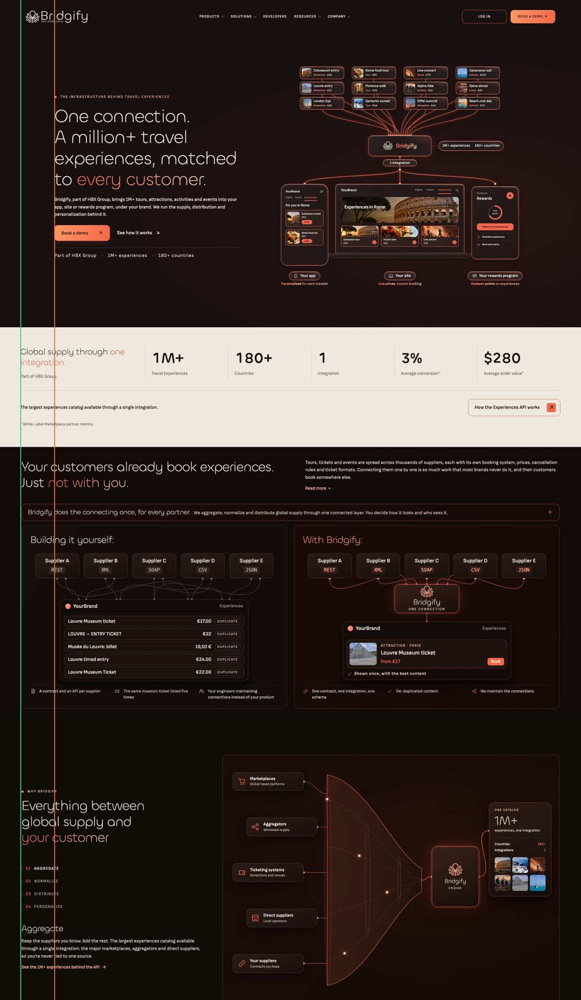
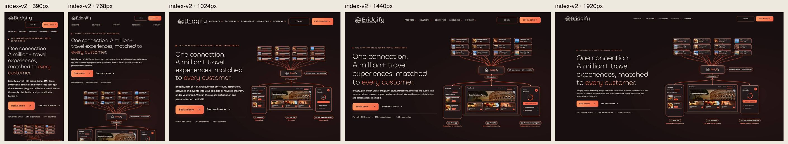
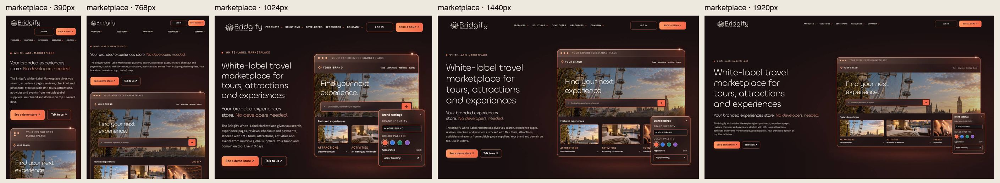
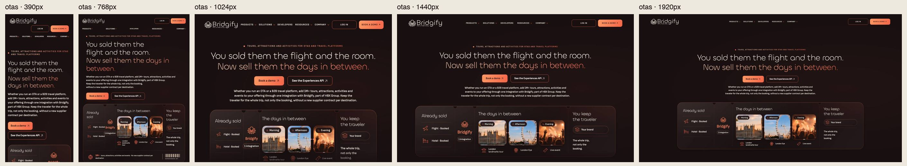
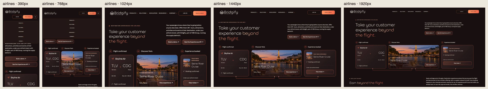
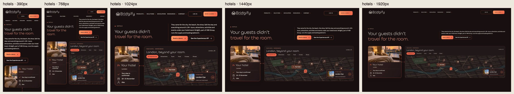
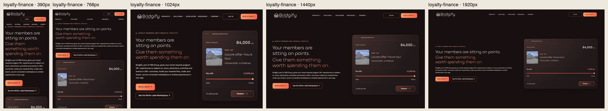
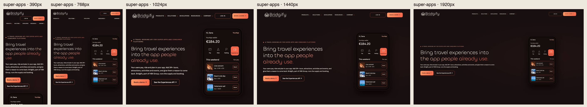
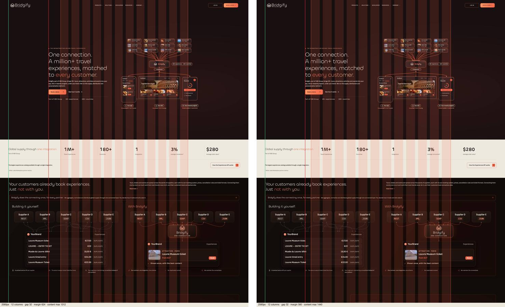

# SPACING-GRID-PLAN · מערכת ריווח וגריד אחת לטלפון, טאבלט ודסקטופ

**מצב (17 בנובמבר 2026):** התוכנית אושרה בכיוון הכללי. כל שלב מאושר בנפרד לפני שממשיכים.

| שלב | מצב |
|---|---|
| 1 · ביקורת | אושר 17 בנובמבר 2026 |
| 2 · breakpoints וגריד | אושר 17 בנובמבר 2026: תוכן עד 1560 (B), שוליים בטאבלט 32, התפריט על קו התוכן |
| 3 · טבלאות ריווח | אושר 17 בנובמבר 2026 (ריווח סקשן בדסקטופ 96). פתוח: גובה כפתור, בלוקי דמו גבוהים |
| 4 · ארכיטקטורה | טיוטה |
| 5 · בדיקות | טיוטה |
| 6 · סדר מעבר | טיוטה |

הכול במעבדה בלבד. קבצי האתר החיים ו־`index.html` (V1) לא משתנים בלי אישור מפורש. הטקסט מגיע רק מ־Copy v4. אין מסגרות ואין שורות Replay/Pause.

**חומרי הביקורת** נמצאים ב־`output/element-lab/grid-plan/`:
- `audit.py`: המדידה של 10 העמודים ב־7 רוחבים.
- `refs.py`: המדידה של Stōkt ו־EnduroSat.
- `measure.json`, `refs.json`: התוצאות.
- `shots/`: צילום מסך ראשון לכל עמוד ולכל רוחב, וצילום עמוד מלא ל־index-v2 ול־api.
- `sheets/`: גיליון לכל עמוד ב־390 / 768 / 1024 / 1440 / 1920.
- `refs/`: צילומי הרפרנסים.

## הקשר
במעבדה (`output/element-lab/adaptive/`, ענף PR #9) הוכחה מערכת ריווח לטלפונים: סולם 8pt, תפקידים (label, title, text, more, actions, link, control, content, visual, dots, deco) וערך אחד לכל זוג תפקידים. היא עובדת רק ב־≤599, ורק דרך `rhythm.js` שכותב `!important` אחרי הצביעה הראשונה (כלל M2 נכשל ב־10 העמודים). הטאבלט והדסקטופ עדיין מתנהגים לפי 167 קובצי CSS, ולכן כל עמוד דרש תיקונים משלו.
המטרה: מסמך תוכנית מאושר (`SPACING-GRID-PLAN.md`) למערכת אחת לשלושת סוגי המכשירים, שמבוססת על מדידות. מבצעים שלב אחרי שלב, ואחרי כל שלב מקבלים אישור. **אין שינוי בקבצים החיים**, אין קומיט ל־main ואין פריסה.

מקורות שנקראו: AGENTS.md (כולל פרק ה־git מענף PR #9), DESIGN.md §3–4, §8, §12–15, TYPOGRAPHY.md, brand-typography.css, ומענף PR #9 (חולץ ב־`git archive` לסקראצ'פד): WORKFLOW.md, MOBILE-RULES.md, tokens.css, actions.css, layout.css, rhythm.js, roles/*.js, check.py, verify.py, check-all.sh, compliance.md, patterns.css.

---

## שלב 1 · ביקורת: מה האתר עושה היום (נמדד)

**איך נמדד:** סקריפט Playwright (`output/element-lab/grid-plan/audit.py`) הגיש את ה־worktree הזה (main, d51e962) בזמן ריצה. הוא מדד את כל הסקשנים ב־10 העמודים ב־390, 768, 820, 1024, 1280, 1440 ו־1920, עם reduced-motion. הסקריפט `refs.py` מדד את Stōkt ואת EnduroSat ב־390, 768, 1440 ו־1920. התוצאות נשמרו ב־`measure.json`, ב־`refs.json` וב־84 צילומי מסך.

### 1א · CSS
- 167 קובצי CSS, 1,358 פעמים `!important`, ו־47 רוחבי breakpoint שונים (בין 360 ל־1800). השכיחים: 760 (140 פעמים), 900/901 (140), 700 (60), 1100 (61) ו־600 (34).
- לכל עמוד נטענים 17–40 קבצים, עם 484–610 `!important` ו־14–31 breakpoints. כ־400 מתוך ה־`!important` של כל עמוד מגיעים מקבצים משותפים: shared-navigation 201, brand-typography 103, brand-faq 51 ו־brand-consistency 34.
- **ממצא מבני:** כל ה־CSS הקיים לא שייך לאף layer, ולכן הוא גובר על כל `@layer` חדש. ה־`!important` שלו יגבר גם על `!important` בשכבות. לכן כל ארכיטקטורה חדשה חייבת קודם להכניס את ה־CSS הקיים לשכבת `legacy`.

### 1ב · שוליים וקו התחלה (צד שמאל של כותרת הסקשן, ברוב הסקשנים)
| רוחב | עמודים פנימיים (`4%`) | דף הבית (`3vw+10`) | חריגים |
|---|---|---|---|
| 390 | 16 | 24 | 13, 14, 20, 23, 36 |
| 768 | 31 | 33 (בהירו 24) | 23–28, 38, 56 |
| 1024 | 41 | 41 | 34, 38, 69 |
| 1280 | 51 | 47 | 42, 86 |
| 1440 | 58 | 53 | 43–48, 96 (OTAs hero: 258) |
| 1920 | 77 | 68–71 | hero דף הבית 180 (תקרה 1560), hero airlines 160 (תקרה 1600), OTAs 426 |
**מסקנה:** יש שתי נוסחאות שוליים ואין תקרה לתוכן, מלבד שני הירו. ב־1920 ההירו של דף הבית מתחיל ב־x=180 והסקשנים שמתחתיו ב־x=68, כלומר הקו השמאלי נשבר. במעבדה הטאבלט כבר מקבל 40px (`layout.css`).

### 1ג · קצב הסקשנים (padding עליון/תחתון, בלי ההירו)
- טווח 0–88 בכל רוחב, חציון 48 ב־390, 56 ב־768–1024 ו־64 ב־1280 ומעלה.
- באותו עמוד יש ערכים שונים לגמרי. למשל API ב־1440: 86/86, ואז 34/44 בסקשן integration. personalization: 64, ‏28 ו־16. FAQ תמיד 72 או 80.
- ה־padding העליון של ההירו: 116–236.

### 1ד · גודל כותרות
| רוחב | כותרת סקשן | הירו | חריגים |
|---|---|---|---|
| 390 (בלי שכבת המעבדה) | 30–36 | 34–42 | 23, 24 |
| 768 / 820 | 36 | 40 (OTAs 48, marketplace 24) | 28, 32, 34 |
| 1024 | 36 | 40 | |
| 1280 | 37–38 | 46 | |
| 1440 | 42–43 | 52 | 27 (sources), 36, 37 |
| 1920 | 44 | 60 | 28, 40 |

### 1ה · ריווח בתוך קבוצת הכותרת (כל הרוחבים)
- label→title: ‏10–28, רוב הערכים 18–22.
- title→text: ‏16–26.
המעבדה קבעה בטלפון 16 ו־24 בדיוק.

### 1ו · רפרנסים (נמדד)
- **EnduroSat:** השוליים נזילים, כ־4.2% מהרוחב: 18 ב־390, 32 ב־768, 60 ב־1440 ו־80 ב־1920. אין תקרה, והטיפוגרפיה גדלה עם vw.
- **Stōkt:** שוליים 16–40, padding סקשן 80/80 בדסקטופ ו־20 בטלפון, וטקסט גוף ברוחב 411–520px גם ב־1920. התוכן הארוך ממורכז בעמודה צרה.

### 1ז · צילומים
השבר בקו השמאלי ב־1920: הקו האדום (x=180) הוא ההירו, והקו הירוק (x=68) הוא כל שאר הסקשנים.



גיליון לכל עמוד, ברוחבים 390 · 768 · 1024 · 1440 · 1920:












---

## שלב 2 · שיטת breakpoints אחת וגריד אחד לכל סוג מכשיר (הצעה)
| | טלפון | טאבלט | דסקטופ |
|---|---|---|---|
| טווח | ≤599 | 600–1023 | ≥1024 |
| רוחבי בדיקה | 320, 390, 430 | 768, 820, 1023 | 1024, 1280, 1440, 1920 |
| עמודות | 4 | 8 | 12 |
| מרווח בין עמודות | 16 | 24 | 32 |
| שוליים | 24 (מוכח) | **32 (אושר)** | `clamp(40px, 4vw, 64px)`: ‏41 ב־1024, ‏51 ב־1280, ‏58 ב־1440 |
| תקרת תוכן | — | — | **1560px (B, אושר 17 בנובמבר 2026)**: `max(clamp(40px, 4vw, 64px), (100vw − 1560px)/2)`. ‏58 ב־1440, ‏180 ב־1920, ‏500 ב־2560 |

- **למה:** בכל סוג מכשיר המרווח בין העמודות הוא כחצי מהשוליים. 4% הוא מה שהעמודים הפנימיים כבר עושים, וקרוב ל־EnduroSat, כך שב־1024–1440 התזוזה היא 0–6px. התקרה מתקנת את השבר ב־1920.
- **רקעים, ארט (`deco`) ובמות דמו רשאים לחרוג מהשוליים** עם `.bf-bleed`. רק התוכן נתפס בגריד.
- מידת טקסט: פסקה עד 60ch (כ־560px). בפיצול כותרת/מבוא בדסקטופ הכותרת תופסת עמודות 1–7 והמבוא עמודות 8–12.
- **הוחלט (המשתמש, 17 בנובמבר 2026):** במסכים רחבים מאוד חייב להיות max-width לתוכן. ההצעה: תוכן עד 1312px (מסגרת 1440), ממורכז, והרקעים נמשכים לכל הרוחב. בשלב 2 מציגים צילומים ב־1920 ו־2560 של 1312 לעומת 1440 ונועלים את המספר.
- **הוחלט (המשתמש, 17 בנובמבר 2026):** שוליים בטאבלט 32.
- **הוחלט (המשתמש, 17 בנובמבר 2026): ה־header על קו התוכן.** הפס הצף זז כך שהלוגו והכפתור האחרון יושבים על הקו, והריווח הפנימי של הפס נשאר מחוץ לקו, כמו ב־Linear. הריווח הפנימי עובר לסולם 8: ‏16 בטאבלט ו־24 בדסקטופ (היום 14, 18 או 24, לפי הרוחב). נמדד בניסוי: הלוגו והכפתור על הקו בדיוק ב־768, ‏1023, ‏1024, ‏1280, ‏1440, ‏1920 ו־2560. חריג אחד: ב־600 הכפתור האחרון יוצא 4px פנימה.

### 2א · ההצעה מצוירת על דף הבית (17 בנובמבר 2026)
`output/element-lab/grid-plan/overlay.py` מצלם את דף הבית ומצייר מעליו את העמודות המוצעות (פסים קורל), את השוליים (קו קורל), ואת הקו השמאלי של היום: ירוק לסקשנים, אדום להירו כשהוא שונה. באתר עצמו לא משתנה כלום.

| רוחב | הקו של היום: הירו / סקשנים | מקסימום 1312 | מקסימום 1440 |
|---|---|---|---|
| 1440 | 53 / 53 | שוליים 64 (זז 11px פנימה) | שוליים 58 (כמו העמודים הפנימיים היום) |
| 1920 | 180 / 68 | שוליים 304 | שוליים 240 |
| 2560 | 500 / 87 | שוליים 624 | שוליים 560 (קרוב להירו של היום) |




**המלצה לתקרה: 1440.** ב־1440, הרוחב הנפוץ ביותר בדסקטופ, העמודים הפנימיים לא זזים בכלל (58px), ודף הבית זז 5px. מעל 1440, ההירו והסקשנים מתיישרים לאותו קו. עם 1312 כל האתר זז פנימה גם ב־1440.

| טאבלט 768 | הקו של היום: הירו / סקשנים | שוליים 40 | שוליים 32 |
|---|---|---|---|
| דף הבית | 24 / 33 | זז 7–16 פנימה | זז 1–8 |


**המלצה לטאבלט: 32.** זה הכי קרוב למה שיש היום (31–33 בעמודים הפנימיים), זהה ל־EnduroSat ב־768, ונמצא על סולם 8. הערך 40 (שהוגדר קודם ב־`layout.css` של המעבדה) נותן יותר אוויר, אבל מזיז את כל הטאבלט.

### 2ב · ניסוי פנימי: דף הבית מסודר לפי תקרה אחת (17 בנובמבר 2026)
המשתמש הרגיש שבמסך רחב הקו המוצע (1440) צר מדי, והציע ללכת על הקו האדום, הקצה של ההירו היום. ‏`try-cap.py` מזריק את `try-cap.css` (מעבדה בלבד) ומצלם את דף הבית בשתי גרסאות:
- **A:** תוכן עד 1440.
- **B:** תוכן עד 1560, כלומר הקו האדום.

בשתיהן השוליים הם `max(clamp(40px, 4vw, 64px), (100vw − cap) / 2)`.

| רוחב | A · ‏1440 | B · ‏1560 | בדיקה |
|---|---|---|---|
| 1440 | 58 | 58 | זהות, התקרה עוד לא פועלת |
| 1920 | 240 | 180 | כל הסקשנים על הקו, ±2px, בלי גלילה אופקית |
| 2560 | 560 | 500 | כל הסקשנים על הקו, ±2px |


**הוחלט (המשתמש, 17 בנובמבר 2026): B, תוכן עד 1560.** המשתמש בדק אותו בתצוגה החיה מול A ומול המצב היום. ההירו נשאר כמו היום, וכל הסקשנים מתיישרים לקו שלו. גם Linear נמדד (תקרה 1280, טלפון 24, טאבלט 34–36, לוגו על קו התוכן). הוא צר יותר מ־A ולא נבחר.

**מה הניסוי לימד:**
- **B משאיר את ההירו בדיוק כמו היום ומיישר אליו את כל השאר.** ב־A גם ההירו מצטמצם (הדיאגרמה קטנה יותר), ו־"Global supply through one integration" נשבר לשלוש שורות ב־1920.
- **חמישה קובצי סקשן בדף הבית מקבעים `padding: … 3.7%`** ולא קוראים את `--home-gutter`: ‏home-products-v2, ‏home-problem-v2, ‏home-numbers-v2 (שני סקשנים), ‏home-cta-v2. גם partner-results מרפד עמודה פנימית. בניסוי הם הופנו לשוליים המשותפים. במיגרציה זה מתוקן במקור.
- **ה־header (לוגו ותפריט) נשאר בקצה המסך** (85px ב־1920, 106px ב־2560) ולא על קו התוכן. צריך להחליט אם גם הוא נכנס לתקרה.

### 2ג · header צמוד לראש הדף, ומצומצם בגלילה (ניסוי, ממתין לאישור)
**הבקשה (המשתמש, 17 בנובמבר 2026):** התפריט לא נראה כבלוק צף נפרד, אלא כ־hero header רגיל שהוא חלק מהדף ומחובר לקצה העליון. בגלילה הוא נהיה תפריט קצת מצומצם, שעדיין צמוד לקצה העליון, בלי לפגוע בקריאוּת.
- **בראש הדף:** הפס ברוחב מלא, מתחיל ב־top 0, בלי פינות מעוגלות ובלי רקע. הוא שקוף מעל ההירו, בגובה 88.
- **בגלילה** (`.is-stuck`, ש־`shared-navigation.js` מוסיף אחרי 24px): אותו פס, צמוד לקצה העליון וברוחב מלא. הגובה יורד ל־64, עם המשטח הכהה של האתר וקו הקורל הדק מתחתיו. הלוגו יורד מ־40 ל־32 והכפתורים מ־44 ל־36.
- **מה לא משתנה:** טקסט הניווט והכפתורים 12px, והצבעים. הריווח בצדי הפס שווה לשולי התוכן, ולכן הלוגו והכפתור האחרון יושבים על קו התוכן בשני המצבים. נמדד: 60 ב־1512, ‏180 ב־1920.
- **איפה:** בדסקטופ בלבד (≥1024). בטאבלט התפריט של האתר בנוי משתי שורות, ויוצא מהמסך כשגוללים למטה.
- **קבצים:** `header-compact.css` (מעבדה). בתצוגה החיה הכפתור "תפריט בגלילה".

## שלב 3 · טבלת ריווח לכל סוג מכשיר (הצעה; ערכי הטלפון נשארים)
| זוג | טוקן | טלפון | טאבלט | דסקטופ |
|---|---|---|---|---|
| label→title | `--bf-gap-label-title` | 16 | 16 | 24 |
| title→text | `--bf-gap-title-text` | 24 | 24 | 32 |
| text→text | `--bf-gap-text-text` | 16 | 16 | 16 |
| text→more | `--bf-gap-text-more` | 8 | 8 | 8 |
| →actions | `--bf-gap-to-actions` | 32 | 40 | 48 |
| button↔button | `--bf-gap-actions-inner` | 12 | 12 | 16 |
| →link | `--bf-gap-to-link` | 16 | 16 | 24 |
| →control | `--bf-gap-to-control` | 32 | 40 | 48 |
| control→content | `--bf-gap-control-content` | 16 | 24 | 32 |
| →content | `--bf-gap-to-content` | 32 | 48 | 64 |
| hero→visual (כשמוערם) | `--bf-gap-to-visual` | 48 | 64 | 64 |
| ראש/תחתית סקשן | `--bf-section-y` | 64 | 80 | 96 (אושר מול 80 ו־128) |
| header→label בהירו | `--bf-hero-top` | 48 | 64 | 80 |
| card pad / gap | `--bf-card-pad` / `--bf-card-gap` | 20 / 16 | 24 / 24 | 32 / 32 |

- **הנימוק (נכתב במסמך לכל שורה):** ריווח של קריאה (text→text, ‏text→more) קשור לגוף 16px, שלא משתנה, ולכן הוא קבוע בכל המכשירים.
- ריווח שקשור לכותרת גדל עם הכותרת (28 → 36 → 44), בערך פי 0.75 מגודלה.
- ריווח מאקרו (סקשן, תוכן) גדל פי 1.25 בטאבלט ופי 1.5 בדסקטופ, מעוגל לסולם 8.
- 96 = הגבול העליון של DESIGN §8. ‏Stōkt משתמש ב־80 בדסקטופ. היום החציון הוא 64 והטווח 0–88.
- **סקשן במה כהה** בגובה מסך (`100svh`) נשאר בגובה המסך. הריווח שלו הוא מינימום.
- **טיפוגרפיה (רק לציון, לא משנים כאן):** טלפון 28 (מאושר). טאבלט 36 לכל הכותרות. דסקטופ לפי הטוקנים הקיימים `--type-section` / `--type-hero`.
- **החלטות פתוחות שעוברות לכאן:** כפתור 40 או 44; גובה הכפתור בטאבלט ובדסקטופ (DESIGN: 54–56 היום); בלוקי דמו גבוהים.

**אושר (המשתמש, 17 בנובמבר 2026):** הטבלה, עם ריווח סקשן של 96 בדסקטופ. האפשרויות שנבדקו בתצוגה החיה היו 80 (Stōkt), ‏96 ו־128 (Linear).

### 3א · ניסוי פנימי על דף הבית (17 בנובמבר 2026)
התצוגה החיה (`output/element-lab/grid-plan/live.html`, כפתור "ריווח · שלב 3") מריצה את הטבלה על דף הבית בטאבלט ובדסקטופ. היא משתמשת באותה מפת תפקידים שאושרה במובייל (`roles-index-v2.js`, הועתקה מ־PR #9) ובאותו כלל זוגות. הערכים נלקחים מ־`tokens-wide.css`, והמנוע הוא `rhythm-wide.js`. מובייל לא משתנה.
- **מה שונה מהמנוע של המובייל:**
  - רק פריטים שמונחים אחד מתחת לשני מקבלים ריווח. פריטים שעומדים זה לצד זה (עמודת טקסט מול ויז'ואל, כפתור ליד לינק) נשארים במקום שלהם.
  - הגובה של ההירו והמיקום האנכי שלו לא משתנים.
  - כותרת השלב ב־"Why Bridgify" (h4, ‏Aggregate וכו') קיימת רק מטאבלט ומעלה, ולכן נוספה כ־`sub`.
- **מדידה (768, ‏1024, ‏1440, ‏1920):** בכל רוחב יש 25–28 זוגות, ו־22–26 מהם נמדדים בדיוק לפי הטוקן. אין גלילה אופקית.
- **חריגים:**
  - **‏#sources ו־#opportunity-study:** בשני הסקשנים יש קו הפרדה עם ריווח פנימי משלו (`trust-footnote`, ‏`pb-bar`). הריווח שנקבע מגיע עד הקו, והטקסט מתחיל מתחתיו.
  - **‏#audiences label→title:** יוצא 38 במקום 24. השורה של ה־label בגריד גבוהה ממנו עצמו, וצריך לתקן את זה במקור.
- צילומים: `trial-space/compare-1440.jpg`, ‏`trial-space/compare-768.jpg` (שמאל היום, ימין שלב 3. השוליים בשניהם לפי B).

## שלב 4 · ארכיטקטורה (הצעה)
1. **סדר השכבות:** `@layer legacy, tokens, base, layout, components, pages, overrides;`. כל ה־CSS הקיים נכנס ל־`legacy` (הכי חלש לכללים רגילים).
2. **בעיית `!important` ב־legacy:** בשכבה הכי נמוכה, `!important` הוא הכי חזק. לכן בכל עמוד שעובר מגירה, מוחקים את ה־`!important` של legacy על מאפייני geometry/spacing של אלמנטים ממופים. הסקריפט `lint.py` שומר baseline לכל קובץ: המספר רק יורד, והוא נכשל אם המספר עלה.
3. **טוקנים שמתחלפים לפי breakpoint:** `system/tokens.css` מקבל בלוקי טאבלט ודסקטופ באותם שמות. ‏breakpoints רק 599/600 ו־1023/1024. בתוך רכיב משתמשים ב־container queries.
4. **utility אחד של container/grid:** `system/grid.css`: ‏`.bf-container` (שוליים ותקרה), ‏`.bf-grid` (4/8/12 עמודות, gap לפי מכשיר), ‏`.bf-span-*`, ‏`.bf-bleed`.
5. **ריתמוס ב־CSS נקי:**
   - באתר החי, מפות התפקידים הופכות למחלקות (`bf-label`, `bf-title`...) עם כללי זוגות (`.bf-title + .bf-text {margin-top: var(--bf-gap-title-text)}`), כמו ב־MOBILE-RULES §7.
   - במעבדה, בלי לגעת בקבצים חיים: `build-css.py` מריץ את המנוע הקיים פעם אחת בכל סוג מכשיר ב־Playwright. מה שהוא כותב (בורר ממפת התפקידים + עטיפות שמנוקות) נשמר כ־`rhythm/<page>.css` סטטי ב־`@layer pages`. `rhythm.js` נשאר רק לבדיקה. כך M2 (קפיצה בטעינה) נפתר כבר במעבדה.
   - סידור הכפתורים (שורה או עמודה) עובר ל־CSS: ‏grid עם `auto-fit`, ובטלפון container query.
6. **"בנייה" של המעבדה:** `build-lab.py` מייצר עותקים של העמודים ב־`output/element-lab/build/<page>.html`. בהם ה־`<link>` של ה־CSS מוחלפים בחבילה אחת, עם `@layer legacy {…}` ואחריה השכבות החדשות. הקבצים החיים לא משתנים. ‏`phone.html` מקבל רוחבי טאבלט ודסקטופ (`frame.html?page=…&w=768`).

## שלב 5 · בדיקות (הצעה)
- `check.py` / `verify.py` מקבלים `--widths 390,768,1024,1440,1920` (וגם 820, 1023, 1280 בהרצה המלאה): WebKit בטלפונים וב־iPad (768, 820), ו־Chromium בדסקטופ.
- **כללים חדשים:**
  - **G1:** כותרות, טקסט וכפתורים מתחילים על קו השוליים, ±1.
  - **G2:** תוכן לא עובר את התקרה ואת השוליים הימניים, חוץ מ־`bf-bleed`.
  - **G3:** אריחים בשורה נצמדים לקצוות העמודות, ±1.
  - **S1–S12** לפי הטבלה של כל מכשיר.
  - **H1:** אין גלילה אופקית.
- **L4 משנה משמעות:** במקום "דסקטופ לא זז", "דסקטופ זהה לצילומי baseline שאושרו". השוואת פיקסלים לכל עמוד ולכל רוחב.
- `lint.py`: ‏breakpoints רק 599/1023, ריווח רק מטוקנים בקבצים חדשים, ומספר ה־`!important` לא עולה.
- `stability.py --mode site` על ה־build (M2) בטלפון ובטאבלט.

## שלב 6 · סדר מעבר ומיגרציה (הצעה)
0. **תשתית:** tokens + grid.css + build-lab.py + frame.html. אין שינוי ויזואלי מלבד השוליים.
1. **רכיבים משותפים שמופיעים בכל עמוד:** header, ‏FAQ (`brand-faq.css`), ‏CTA סוגר + פוטר, ‏`xc-grid` (section-4 בעמודי הפתרונות).
2. **index-v2:** הכי הרבה סקשנים, ונוסחת שוליים משלו.
3. **api:** העמוד שבו נבחרה כותרת 28.
4. **marketplace, ‏personalization.**
5. **שישה עמודי פתרונות:** ‏otas, ‏airlines, ‏hotels, ‏loyalty-finance, ‏super-apps, ‏travel-technology. מבנה משותף.

**לכל עמוד:**
- מפת תפקידים לכל סוג מכשיר.
- `build-css`.
- `verify.py` ב־7 רוחבים.
- גיליון צילומים לפני/אחרי (בטלפון, בטאבלט ובדסקטופ).
- אישור הבעלים.

**המעבר לאתר החי** (מחלקות במרקאפ, legacy layer, הסרת `!important`) הוא שלב נפרד, באישור מפורש ועמוד אחרי עמוד, ב־PR לענף.

---

## שחזור המדידה
```bash
python3 output/element-lab/grid-plan/audit.py --shots
python3 output/element-lab/grid-plan/refs.py
```
